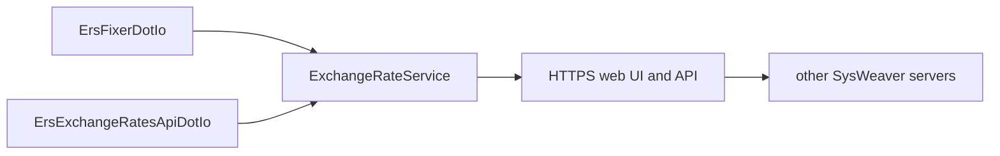

# ExchangeRateService

[⬆ SysWeaver.Services overview](../README.md)

> Stand-alone exchange rate server: hosts SysWeaver.ExchangeRate with fixer.io and exchangeratesapi.io sources behind an authenticated HTTPS web UI and API.

| | |
|---|---|
| **Layer** | Service (application) |
| **Kind** | Application |

## Purpose

Fetch currency exchange rates from commercial providers in one place and serve them to people (tables, charts, Excel export) and to other SysWeaver servers, so that each application doesn't need its own provider subscription.

## How it fits into SysWeaver

The executable only contains the entry point; all functionality comes from [SysWeaver.ExchangeRate](https://github.com/dosh1974/SysWeaver/blob/main/SysWeaver.ExchangeRate/README.md) and the web platform services, composed in the manifest.

## Running it

- Started with `ServiceHost.Run` ([SysWeaver.OsServices](https://github.com/dosh1974/SysWeaver/blob/main/SysWeaver.OsServices/README.md)), service name `ExchangeRateService`: `ExchangeRateService debug` runs it in the console, `ExchangeRateService install` / `start` installs and runs it as an OS service (requires elevation).
- Manifest: [`ExchangeRateService.Services.json`](ExchangeRateService.Services.json) (copied to the output folder). Key services:
  - `ErsFixerDotIo` and `ErsExchangeRatesApiDotIo` rate sources (API keys in `C:\Keys\fixer.io.txt` and `C:\Keys\exchangeratesapi.io.txt`), `ExchangeRateService` and `ExchangeRateDebugService`
  - `SimpleAuthorizer` (users in `C:\Keys\ExchangeRateUsers.txt`), `AuthManagerService`, `LoginService`
  - the standard web UI services (`StaticDataHttpServerService`, `ApiHttpServerService`, `IconHttpServerService`, `ExploreHttpServerService`, `WebMenuService`, `TypeService`, `IsoDataService`), `ChartJsService`, `ExcelService` and `ChartJsExcelService` (GemBox license in `C:\Keys\GemBox.Spreadsheet.txt`)
  - `MySqlApiAuditService` (API audit in the `ExchangeRateAudit` schema, credentials in `C:\Keys\MySql.txt`)
  - `NetHttpServerService` listening on `https://*:443/` with a `SelfSignedCertificateProvider` certificate for `exchangerates.sysweaver.com`, `FirewallHandler`
- Serves the exchange rate tables and APIs (including the sync API used by other servers) over HTTPS.

## Limitations and considerations

- The shipped manifest is the author's own configuration: key file locations, host name, MySQL credentials and the development `FileHttpServerModule` folders (`D:\SysWeaver\...\srcWeb`) must be adapted.
- The commercial sources require API keys and limit how often rates can be fetched.
- The publish profile targets `win-x64` (self-contained); the Unix service host factory is referenced, so it can also be run as a systemd service when published for Linux.

## Folder layout

| Folder | Content |
|---|---|
| [`Properties/`](Properties/README.md) | Publish profile (self-contained win-x64) |

## Relationships

- **Project:** [`ExchangeRateService.csproj`](ExchangeRateService.csproj)
- **Builds on:** [SysWeaver.Serialization.NewtonsoftJson](https://github.com/dosh1974/SysWeaver/blob/main/Serialization/SysWeaver.Serialization.NewtonsoftJson/README.md), [SysWeaver.Excel](https://github.com/dosh1974/SysWeaver/blob/main/SysWeaver.Excel/README.md), [SysWeaver.ExchangeRate](https://github.com/dosh1974/SysWeaver/blob/main/SysWeaver.ExchangeRate/README.md), [SysWeaver.IsoData](https://github.com/dosh1974/SysWeaver/blob/main/SysWeaver.IsoData/README.md), [SysWeaver.MicroService.Auth](https://github.com/dosh1974/SysWeaver/blob/main/SysWeaver.MicroService.Auth/README.md), [SysWeaver.MicroService.ChartJs.Excel](https://github.com/dosh1974/SysWeaver/blob/main/SysWeaver.MicroService.ChartJs.Excel/README.md), [SysWeaver.MicroService.ChartJs](https://github.com/dosh1974/SysWeaver/blob/main/SysWeaver.MicroService.ChartJs/README.md), [SysWeaver.MicroService.Edit](https://github.com/dosh1974/SysWeaver/blob/main/SysWeaver.MicroService.Edit/README.md), [SysWeaver.MicroService.MySqlAudit](https://github.com/dosh1974/SysWeaver/blob/main/SysWeaver.MicroService.MySqlAudit/README.md), [SysWeaver.MicroService.NetHttpServer](https://github.com/dosh1974/SysWeaver/blob/main/SysWeaver.MicroService.NetHttpServer/README.md), [SysWeaver.MicroServices.Log](https://github.com/dosh1974/SysWeaver/blob/main/SysWeaver.MicroServices.Log/README.md), [SysWeaver.MicroServices.ServiceManager](https://github.com/dosh1974/SysWeaver/blob/main/SysWeaver.MicroServices.ServiceManager/README.md), [SysWeaver.OsServices.ServiceHostFactoryUnix](https://github.com/dosh1974/SysWeaver/blob/main/Platform/SysWeaver.OsServices.ServiceHostFactoryUnix/README.md), [SysWeaver.OsServices.ServiceHostFactoryWin32NT](https://github.com/dosh1974/SysWeaver/blob/main/Platform/SysWeaver.OsServices.ServiceHostFactoryWin32NT/README.md), [SysWeaver.OsServices](https://github.com/dosh1974/SysWeaver/blob/main/SysWeaver.OsServices/README.md), [SysWeaver.Security.Acme](https://github.com/dosh1974/SysWeaver/blob/main/SysWeaver.Security.Acme/README.md), [SysWeaver.Serialization.SwJson](https://github.com/dosh1974/SysWeaver/blob/main/Serialization/SysWeaver.Serialization.SwJson/README.md)
