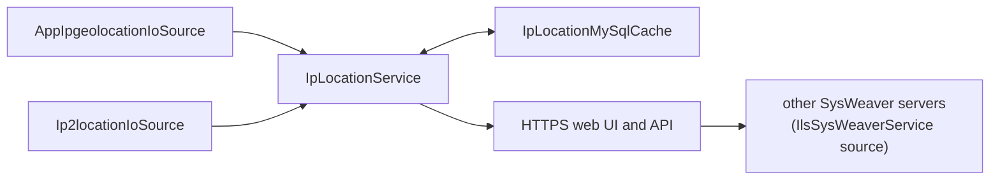

# IpLocationService

[⬆ SysWeaver.Services overview](../README.md)

> Stand-alone IP geolocation server: hosts SysWeaver.IpLocation with commercial web API sources and a MySQL cache behind an authenticated HTTPS web UI and API.

| | |
|---|---|
| **Layer** | Service (application) |
| **Kind** | Application |

## Purpose

Resolve IP addresses to locations in one place, caching every lookup in a database so that paid lookups are made only once, and serve the result to people and to other SysWeaver servers.

## How it fits into SysWeaver

The executable only contains the entry point; all functionality comes from [SysWeaver.IpLocation](https://github.com/dosh1974/SysWeaver/blob/main/SysWeaver.IpLocation/README.md), [SysWeaver.IpLocation.MySqlCache](https://github.com/dosh1974/SysWeaver/blob/main/SysWeaver.IpLocation.MySqlCache/README.md) and the web platform services, composed in the manifest.

## Running it

- Started with `ServiceHost.Run` ([SysWeaver.OsServices](https://github.com/dosh1974/SysWeaver/blob/main/SysWeaver.OsServices/README.md)), service name `IpLocationService`: `IpLocationService debug` runs it in the console, `IpLocationService install` / `start` installs and runs it as an OS service (requires elevation).
- Manifest: [`IpLocationService.Services.json`](IpLocationService.Services.json) (copied to the output folder). Key services:
  - `AppIpgeolocationIoSource` and `Ip2locationIoSource` (API keys in `C:\Keys\app.ipgeolocation.io.txt` and `C:\Keys\ip2location.io.txt`), `IpLocationMySqlCache` (`C:\Keys\MySql.txt`) and `IpLocationService`; an `IlsSysWeaverService` source (using another server) is present but commented out
  - `SimpleAuthorizer` (users in `C:\Keys\IpLocationUsers.txt`), `AuthManagerService`, `LoginService`
  - the standard web UI services (`StaticDataHttpServerService`, `ApiHttpServerService`, `IconHttpServerService`, `ExploreHttpServerService`, `WebMenuService`, `TypeService`, `IsoDataService`), `ChartJsService`, `ExcelService` and `ChartJsExcelService` (GemBox license in `C:\Keys\GemBox.Spreadsheet.txt`)
  - `MySqlApiAuditService` (API audit in the `IpLocation` schema)
  - `NetHttpServerService` listening on `https://*:443/` (basic auth allowed) with a `SelfSignedCertificateProvider` certificate for `iplocation.sysweaver.com`, `FirewallHandler`
- Serves IP location lookups (API and tables) over HTTPS.

## Limitations and considerations

- Requires a MySQL server for the cache and the API audit.
- The commercial sources require API keys and are rate / quota limited.
- The shipped manifest is the author's own configuration: key file locations, host name and the development `FileHttpServerModule` folders (`D:\SysWeaver\...\srcWeb`) must be adapted.
- The publish profile targets `win-x64` (self-contained); the Unix service host factory is referenced, so it can also be run as a systemd service when published for Linux.

## Folder layout

| Folder | Content |
|---|---|
| [`Properties/`](Properties/README.md) | Publish profile (self-contained win-x64) |

## Relationships

- **Project:** [`IpLocationService.csproj`](IpLocationService.csproj)
- **Builds on:** [SysWeaver.Excel](https://github.com/dosh1974/SysWeaver/blob/main/SysWeaver.Excel/README.md), [SysWeaver.IpLocation.MySqlCache](https://github.com/dosh1974/SysWeaver/blob/main/SysWeaver.IpLocation.MySqlCache/README.md), [SysWeaver.IpLocation](https://github.com/dosh1974/SysWeaver/blob/main/SysWeaver.IpLocation/README.md), [SysWeaver.MicroService.Auth](https://github.com/dosh1974/SysWeaver/blob/main/SysWeaver.MicroService.Auth/README.md), [SysWeaver.MicroService.ChartJs.Excel](https://github.com/dosh1974/SysWeaver/blob/main/SysWeaver.MicroService.ChartJs.Excel/README.md), [SysWeaver.MicroService.Edit](https://github.com/dosh1974/SysWeaver/blob/main/SysWeaver.MicroService.Edit/README.md), [SysWeaver.MicroService.MySqlAudit](https://github.com/dosh1974/SysWeaver/blob/main/SysWeaver.MicroService.MySqlAudit/README.md), [SysWeaver.MicroService.NetHttpServer](https://github.com/dosh1974/SysWeaver/blob/main/SysWeaver.MicroService.NetHttpServer/README.md), [SysWeaver.MicroServices.Log](https://github.com/dosh1974/SysWeaver/blob/main/SysWeaver.MicroServices.Log/README.md), [SysWeaver.MicroServices.ServiceManager](https://github.com/dosh1974/SysWeaver/blob/main/SysWeaver.MicroServices.ServiceManager/README.md), [SysWeaver.OsServices.ServiceHostFactoryUnix](https://github.com/dosh1974/SysWeaver/blob/main/Platform/SysWeaver.OsServices.ServiceHostFactoryUnix/README.md), [SysWeaver.OsServices.ServiceHostFactoryWin32NT](https://github.com/dosh1974/SysWeaver/blob/main/Platform/SysWeaver.OsServices.ServiceHostFactoryWin32NT/README.md), [SysWeaver.OsServices](https://github.com/dosh1974/SysWeaver/blob/main/SysWeaver.OsServices/README.md), [SysWeaver.Security.Acme](https://github.com/dosh1974/SysWeaver/blob/main/SysWeaver.Security.Acme/README.md), [SysWeaver.Serialization.SwJson](https://github.com/dosh1974/SysWeaver/blob/main/Serialization/SysWeaver.Serialization.SwJson/README.md)
