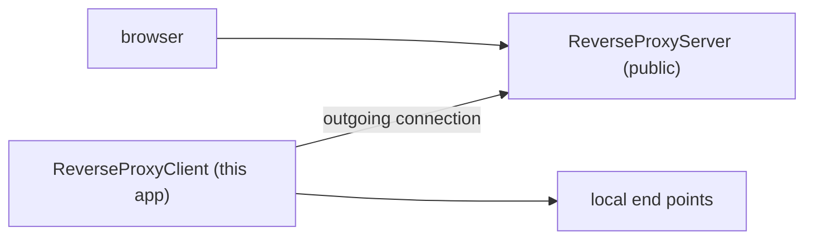

# ReverseProxyClient

[⬆ SysWeaver.Services overview](../README.md)

> Example reverse proxy client: connects out to a ReverseProxyServer so that this machine's web end points become reachable through the public server.

| | |
|---|---|
| **Layer** | Service (application) |
| **Kind** | Application |
| **Platform** | Windows (only the Win32NT service host factory is referenced; elsewhere only the console verbs work) |

## Purpose

Make services on a machine without a public address (no public IP, no port forwarding) reachable from the internet, by keeping an outgoing connection to a public [ReverseProxyServer](../ReverseProxyServer/README.md). It doubles as an example of how to configure the client side of [SysWeaver.ReverseProxy](https://github.com/dosh1974/SysWeaver/blob/main/SysWeaver.ReverseProxy/README.md).

## How it fits into SysWeaver

## Running it

- Started with `ServiceHost.Run` ([SysWeaver.OsServices](https://github.com/dosh1974/SysWeaver/blob/main/SysWeaver.OsServices/README.md)), service name `ReverseProxyClient`: `ReverseProxyClient debug` runs it in the console, `ReverseProxyClient install` / `start` installs and runs it as a Windows service (requires elevation).
- Manifest: [`ReverseProxyClient.Services.json`](ReverseProxyClient.Services.json) (copied to the output folder). Key services:
  - `ReverseProxyClient`: the server url is read from `$(KeyFolder)/ReverseProxyClient_Server.txt` and the credentials from `$(KeyFolder)/ReverseProxyClient_ReverseProxyServer.txt`; with no end points configured it exposes this service itself
  - `SimpleAuthorizer` (users in `$(KeyFolder)/ReverseProxyClient_Users.txt`), `AuthManagerService`, `LoginService`
  - the standard web UI services (`StaticDataHttpServerService`, `ApiHttpServerService`, `IconHttpServerService`, `ExploreHttpServerService`, `WebMenuService`, `TypeService`)
  - `NetHttpServerService` listening on `https://*:9443` with a `LanCertificateProvider` certificate (from a [SwLanCertManager](../SwLanCertManager/README.md)), `FirewallHandler`; an `AcmeCertificateProvider` entry is commented out
- `$(KeyFolder)` defaults to `C:\Keys` on Windows (configurable with the `KeyFolder` key in `ReverseProxyClient.Config.json`).
- Serves its own web UI locally and its end points through the reverse proxy server.

## Limitations and considerations

- Needs a running [ReverseProxyServer](../ReverseProxyServer/README.md) and service credentials for it.
- The `LanCertificateProvider` needs a reachable LAN certificate manager and its key files; switch to another certificate provider if none is available.

## Relationships

- **Project:** [`ReverseProxyClient.csproj`](ReverseProxyClient.csproj)
- **Builds on:** [SysWeaver.MicroService.Auth](https://github.com/dosh1974/SysWeaver/blob/main/SysWeaver.MicroService.Auth/README.md), [SysWeaver.MicroService.Edit](https://github.com/dosh1974/SysWeaver/blob/main/SysWeaver.MicroService.Edit/README.md), [SysWeaver.MicroService.NetHttpServer](https://github.com/dosh1974/SysWeaver/blob/main/SysWeaver.MicroService.NetHttpServer/README.md), [SysWeaver.MicroServices.Log](https://github.com/dosh1974/SysWeaver/blob/main/SysWeaver.MicroServices.Log/README.md), [SysWeaver.OsServices.ServiceHostFactoryWin32NT](https://github.com/dosh1974/SysWeaver/blob/main/Platform/SysWeaver.OsServices.ServiceHostFactoryWin32NT/README.md), [SysWeaver.ReverseProxy](https://github.com/dosh1974/SysWeaver/blob/main/SysWeaver.ReverseProxy/README.md), [SysWeaver.Security](https://github.com/dosh1974/SysWeaver/blob/main/SysWeaver.Security/README.md), [SysWeaver.Serialization.SwJson](https://github.com/dosh1974/SysWeaver/blob/main/Serialization/SysWeaver.Serialization.SwJson/README.md)
