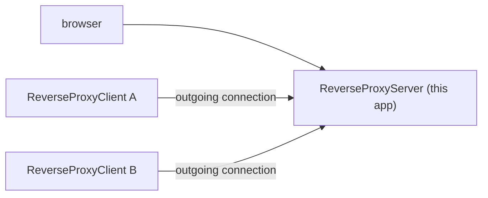

# ReverseProxyServer

[⬆ SysWeaver.Services overview](../README.md)

> Example public facing reverse proxy server: reverse proxy clients connect to it, and it routes incoming HTTPS requests to their end points.

| | |
|---|---|
| **Layer** | Service (application) |
| **Kind** | Application |
| **Platform** | Windows (only the Win32NT service host factory is referenced; elsewhere only the console verbs work) |

## Purpose

Run on a machine reachable from the internet and give access to services on machines that are not, through [ReverseProxyClient](../ReverseProxyClient/README.md) instances that connect to it. It doubles as an example of how to configure the server side of [SysWeaver.ReverseProxy](https://github.com/dosh1974/SysWeaver/blob/main/SysWeaver.ReverseProxy/README.md).

## How it fits into SysWeaver

Requests are routed by sub path (default: `ReverseProxyFiles/<client id>-<end point>/...`) or by domain name, see [SysWeaver.ReverseProxy](https://github.com/dosh1974/SysWeaver/blob/main/SysWeaver.ReverseProxy/README.md).

## Running it

- Started with `ServiceHost.Run` ([SysWeaver.OsServices](https://github.com/dosh1974/SysWeaver/blob/main/SysWeaver.OsServices/README.md)), service name `ReverseProxyServer`: `ReverseProxyServer debug` runs it in the console, `ReverseProxyServer install` / `start` installs and runs it as a Windows service (requires elevation).
- Manifest: [`ReverseProxyServer.Services.json`](ReverseProxyServer.Services.json) (copied to the output folder). Key services:
  - `ReverseProxyServer` (default parameters)
  - `SimpleAuthorizer` (users, including the clients' service accounts, in `$(KeyFolder)/ReverseProxyServer_Users.txt`), `AuthManagerService`, `LoginService`
  - the standard web UI services (`StaticDataHttpServerService`, `ApiHttpServerService`, `IconHttpServerService`, `ExploreHttpServerService`, `WebMenuService`, `TypeService`)
  - `NetHttpServerService` listening on `https://*` with a `LanCertificateProvider` certificate, `FirewallHandler`; an `AcmeCertificateProvider` entry (public certificates) is commented out
- `$(KeyFolder)` defaults to `C:\Keys` on Windows (configurable with the `KeyFolder` key in `ReverseProxyServer.Config.json`).
- Serves the proxied client end points and its own web UI over HTTPS.

## Limitations and considerations

- For a real public server the `LanCertificateProvider` should be replaced by a public certificate (ex: the commented out `AcmeCertificateProvider`).
- Sub path routing breaks sites that use rooted paths; domain routing needs DNS records and certificates per client end point (see [SysWeaver.ReverseProxy](https://github.com/dosh1974/SysWeaver/blob/main/SysWeaver.ReverseProxy/README.md)).

## Folder layout

| Folder | Content |
|---|---|
| [`Properties/`](Properties/README.md) | Publish profile (self-contained win-x64) |

## Relationships

- **Project:** [`ReverseProxyServer.csproj`](ReverseProxyServer.csproj)
- **Builds on:** [SysWeaver.MicroService.Auth](https://github.com/dosh1974/SysWeaver/blob/main/SysWeaver.MicroService.Auth/README.md), [SysWeaver.MicroService.Edit](https://github.com/dosh1974/SysWeaver/blob/main/SysWeaver.MicroService.Edit/README.md), [SysWeaver.MicroService.NetHttpServer](https://github.com/dosh1974/SysWeaver/blob/main/SysWeaver.MicroService.NetHttpServer/README.md), [SysWeaver.MicroServices.Log](https://github.com/dosh1974/SysWeaver/blob/main/SysWeaver.MicroServices.Log/README.md), [SysWeaver.OsServices.ServiceHostFactoryWin32NT](https://github.com/dosh1974/SysWeaver/blob/main/Platform/SysWeaver.OsServices.ServiceHostFactoryWin32NT/README.md), [SysWeaver.ReverseProxy](https://github.com/dosh1974/SysWeaver/blob/main/SysWeaver.ReverseProxy/README.md), [SysWeaver.Security.Acme](https://github.com/dosh1974/SysWeaver/blob/main/SysWeaver.Security.Acme/README.md), [SysWeaver.Security](https://github.com/dosh1974/SysWeaver/blob/main/SysWeaver.Security/README.md), [SysWeaver.Serialization.SwJson](https://github.com/dosh1974/SysWeaver/blob/main/Serialization/SysWeaver.Serialization.SwJson/README.md)
