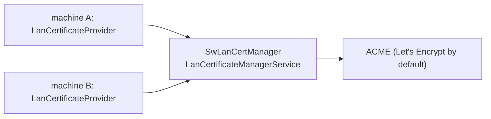

# SwLanCertManager

[⬆ SysWeaver.Services overview](../README.md)

> Central LAN certificate manager: hosts SysWeaver.MicroService.LanCertificateManager so that other SysWeaver machines can obtain and renew certificates for LAN host names.

| | |
|---|---|
| **Layer** | Service (application) |
| **Kind** | Application |
| **Platform** | Windows (only the Win32NT service host factory is referenced; elsewhere only the console verbs work) |

## Purpose

Give internal machines valid HTTPS certificates for LAN host names from one place, instead of managing certificates on each machine. Machines that use the `LanCertificateProvider` from [SysWeaver.Security](https://github.com/dosh1974/SysWeaver/blob/main/SysWeaver.Security/README.md) request and renew their certificates from this service.

## How it fits into SysWeaver

## Running it

- Started with `ServiceHost.Run` ([SysWeaver.OsServices](https://github.com/dosh1974/SysWeaver/blob/main/SysWeaver.OsServices/README.md)), service name `SysWeaver.LanCert` (restart on failure enabled): `SwLanCertManager debug` runs it in the console, `SwLanCertManager install` / `start` installs and runs it as a Windows service (requires elevation).
- Manifest: [`SwLanCertManager.Services.json`](SwLanCertManager.Services.json) (copied to the output folder). Key services:
  - `LanCertificateManagerService`, with `Email` and `Domains` left empty in the shipped manifest (must be filled in)
  - `SimpleAuthorizer` (users, including the client machines' service accounts, in `$(KeyFolder)/LanCertManager_Users.txt`), `AuthManagerService`, `LoginService`
  - the standard web UI services (`StaticDataHttpServerService`, `ApiHttpServerService`, `IconHttpServerService`, `ExploreHttpServerService`, `WebMenuService`, `TypeService`)
  - `NetHttpServerService` listening on `https://*` with a `LanCertificateProvider` certificate, `FirewallHandler`; `SelfSignedCertificateProvider` and `AcmeCertificateProvider` alternatives are commented out
- `$(KeyFolder)` defaults to `C:\Keys` on Windows (configurable with the `KeyFolder` key in `SwLanCertManager.Config.json`).
- Serves the certificate API for the LAN machines and an admin web UI over HTTPS.

## Limitations and considerations

- The manager is a single point of trust and availability for all LAN certificates.
- `Email` and `Domains` must be configured before certificates can be issued.

## Relationships

- **Project:** [`SwLanCertManager.csproj`](SwLanCertManager.csproj)
- **Builds on:** [SysWeaver.HttpServer.ExploreModule](https://github.com/dosh1974/SysWeaver/blob/main/SysWeaver.HttpServer.ExploreModule/README.md), [SysWeaver.HttpServer.IconModule](https://github.com/dosh1974/SysWeaver/blob/main/SysWeaver.HttpServer.IconModule/README.md), [SysWeaver.MicroService.Auth](https://github.com/dosh1974/SysWeaver/blob/main/SysWeaver.MicroService.Auth/README.md), [SysWeaver.MicroService.Edit](https://github.com/dosh1974/SysWeaver/blob/main/SysWeaver.MicroService.Edit/README.md), [SysWeaver.MicroService.HttpServer](https://github.com/dosh1974/SysWeaver/blob/main/SysWeaver.MicroService.HttpServer/README.md), [SysWeaver.MicroService.LanCertificateManager](https://github.com/dosh1974/SysWeaver/blob/main/SysWeaver.MicroService.LanCertificateManager/README.md), [SysWeaver.MicroService.NetHttpServer](https://github.com/dosh1974/SysWeaver/blob/main/SysWeaver.MicroService.NetHttpServer/README.md), [SysWeaver.MicroServices.Log](https://github.com/dosh1974/SysWeaver/blob/main/SysWeaver.MicroServices.Log/README.md), [SysWeaver.OsServices.ServiceHostFactoryWin32NT](https://github.com/dosh1974/SysWeaver/blob/main/Platform/SysWeaver.OsServices.ServiceHostFactoryWin32NT/README.md), [SysWeaver.Serialization.SwJson](https://github.com/dosh1974/SysWeaver/blob/main/Serialization/SysWeaver.Serialization.SwJson/README.md)
