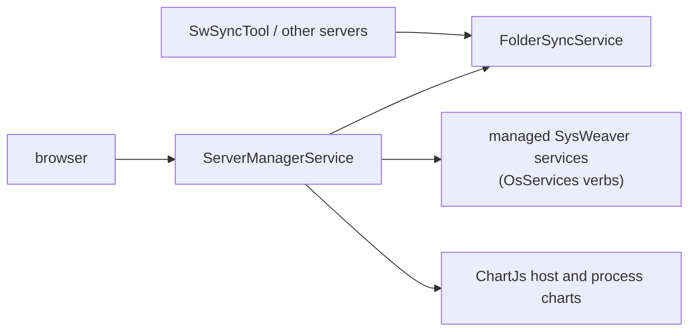

# SwServerManager

[⬆ SysWeaver.Services overview](../README.md)

> Per-machine server manager: hosts SysWeaver.MicroService.ServerManager and FolderSync to deploy, control and monitor the SysWeaver services and folders on a host, on Windows and Linux.

| | |
|---|---|
| **Layer** | Service (application) |
| **Kind** | Application |

## Purpose

Run one manager on every SysWeaver machine to operate it from the browser: deploy new service versions through folder sync (ex: pushed with `SwSyncTool` from [SysWeaver.Tools](https://github.com/dosh1974/SysWeaver.Tools)), start, stop and restart services, keep backups and configurations, view text and log files, and monitor CPU, memory and drives.

## How it fits into SysWeaver

The executable only contains the entry point; the functionality comes from [SysWeaver.MicroService.ServerManager](https://github.com/dosh1974/SysWeaver/blob/main/SysWeaver.MicroService.ServerManager/README.md), [SysWeaver.MicroService.FolderSync](https://github.com/dosh1974/SysWeaver/blob/main/SysWeaver.MicroService.FolderSync/README.md) and the web platform services, composed in the manifest.

## Running it

- Started with `ServiceHost.Run` ([SysWeaver.OsServices](https://github.com/dosh1974/SysWeaver/blob/main/SysWeaver.OsServices/README.md)), service name `SysWeaver.ServerManager` (restart on failure enabled): `SwServerManager debug` runs it in the console, `SwServerManager install` / `start` installs and runs it as a Windows service or systemd unit (requires elevation).
- Manifests (copied to the output folder): the OS specific `<Exe>.Services.<OS>.json` is used if present, else `<Exe>.Services.json`:
  - [`SwServerManager.Services.json`](SwServerManager.Services.json) (Windows): `ServerManagerService` (managing the `IpLocationService` and `GameWeaver` services, MySQL text files), `FolderSyncService` (a `Test` managed folder), `FileUploaderService`, `MediaService`, `ChartJsService`, `MySqlApiAuditService` (`ServerManager` schema), the standard web UI services, `SimpleAuthorizer` (users in `$(KeyFolder)/ServerManager_Users.txt`) with `AuthManagerService` / `LoginService`, `AspHttpServerService` on `https://*` with a `LanCertificateProvider` certificate and `FirewallHandler`
  - [`SwServerManager.Services.Linux.json`](SwServerManager.Services.Linux.json) (Linux): the same set without managed services, managed folders and text files, using a `SelfSignedCertificateProvider` certificate
- [`SwServerManager.Config.jsonxx`](SwServerManager.Config.jsonxx): a disabled application config (sets `AllFolders`); rename it to `SwServerManager.Config.json` to use it.
- `AppInfo` names the application `$(MachineNameCased)Manager`, so each machine's manager shows its own name.
- Publish profiles: `Properties/PublishProfiles/WIndows_x64.pubxml` (win-x64) and `Linux_x64.pubxml` (linux-x64), both self-contained.
- Serves the server manager web UI and the folder sync and management APIs over HTTPS.

## Limitations and considerations

- Runs elevated and can control services, edit files and reboot the machine: protect the users file and the network access.
- The shipped manifests are the author's own configuration: key files, MySQL, managed service names, text files and the development `FileHttpServerModule` folders (`D:\SysWeaver\...\srcWeb`, `D:\Temp`, `D:\Effects`) must be adapted.

## Folder layout

| Folder | Content |
|---|---|
| [`Properties/`](Properties/README.md) | Publish profiles (self-contained win-x64 and linux-x64) |

## Relationships

- **Project:** [`SwServerManager.csproj`](SwServerManager.csproj)
- **Builds on:** [SysWeaver.Compression.ZstdSharp](https://github.com/dosh1974/SysWeaver/blob/main/Compression/SysWeaver.Compression.ZstdSharp/README.md), [SysWeaver.HttpServer.ExploreModule](https://github.com/dosh1974/SysWeaver/blob/main/SysWeaver.HttpServer.ExploreModule/README.md), [SysWeaver.HttpServer.IconModule](https://github.com/dosh1974/SysWeaver/blob/main/SysWeaver.HttpServer.IconModule/README.md), [SysWeaver.HttpTransformer.Compress](https://github.com/dosh1974/SysWeaver/blob/main/SysWeaver.HttpTransformer.Compress/README.md), [SysWeaver.HttpTransformer.Image](https://github.com/dosh1974/SysWeaver/blob/main/SysWeaver.HttpTransformer.Image/README.md), [SysWeaver.MicroService.AspHttpServer](https://github.com/dosh1974/SysWeaver/blob/main/SysWeaver.MicroService.AspHttpServer/README.md), [SysWeaver.MicroService.Auth](https://github.com/dosh1974/SysWeaver/blob/main/SysWeaver.MicroService.Auth/README.md), [SysWeaver.MicroService.Edit](https://github.com/dosh1974/SysWeaver/blob/main/SysWeaver.MicroService.Edit/README.md), [SysWeaver.MicroService.FileUploader](https://github.com/dosh1974/SysWeaver/blob/main/SysWeaver.MicroService.FileUploader/README.md), [SysWeaver.MicroService.FolderSync](https://github.com/dosh1974/SysWeaver/blob/main/SysWeaver.MicroService.FolderSync/README.md), [SysWeaver.MicroService.HttpServer](https://github.com/dosh1974/SysWeaver/blob/main/SysWeaver.MicroService.HttpServer/README.md), [SysWeaver.MicroService.Media](https://github.com/dosh1974/SysWeaver/blob/main/SysWeaver.MicroService.Media/README.md), [SysWeaver.MicroService.MySqlAudit](https://github.com/dosh1974/SysWeaver/blob/main/SysWeaver.MicroService.MySqlAudit/README.md), [SysWeaver.MicroService.NetHttpServer](https://github.com/dosh1974/SysWeaver/blob/main/SysWeaver.MicroService.NetHttpServer/README.md), [SysWeaver.MicroService.ServerManager](https://github.com/dosh1974/SysWeaver/blob/main/SysWeaver.MicroService.ServerManager/README.md), [SysWeaver.MicroServices.Log](https://github.com/dosh1974/SysWeaver/blob/main/SysWeaver.MicroServices.Log/README.md), [SysWeaver.MicroServices.ServiceManager](https://github.com/dosh1974/SysWeaver/blob/main/SysWeaver.MicroServices.ServiceManager/README.md), [SysWeaver.OsServices.ServiceHostFactoryUnix](https://github.com/dosh1974/SysWeaver/blob/main/Platform/SysWeaver.OsServices.ServiceHostFactoryUnix/README.md), [SysWeaver.OsServices.ServiceHostFactoryWin32NT](https://github.com/dosh1974/SysWeaver/blob/main/Platform/SysWeaver.OsServices.ServiceHostFactoryWin32NT/README.md), [SysWeaver.ReverseProxy](https://github.com/dosh1974/SysWeaver/blob/main/SysWeaver.ReverseProxy/README.md), [SysWeaver.Security.Acme](https://github.com/dosh1974/SysWeaver/blob/main/SysWeaver.Security.Acme/README.md), [SysWeaver.Security](https://github.com/dosh1974/SysWeaver/blob/main/SysWeaver.Security/README.md), [SysWeaver.Serialization.SwJson](https://github.com/dosh1974/SysWeaver/blob/main/Serialization/SysWeaver.Serialization.SwJson/README.md)
