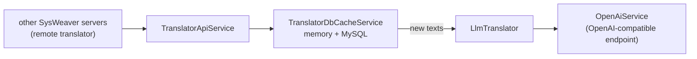

# TranslationService

[⬆ SysWeaver.Services overview](../README.md)

> Translation server: an LLM based translator behind a memory and MySQL cache, exposed as a web API (with a translation editor) for other SysWeaver services.

| | |
|---|---|
| **Layer** | Service (application) |
| **Kind** | Application |
| **Platform** | Windows (only the Win32NT service host factory is referenced; elsewhere only the console verbs work) |

## Purpose

Translate each distinct text once for all SysWeaver applications: other servers use this service as their remote translator, new texts are translated by a large language model, and the results are cached in memory and MySQL where they can be reviewed and corrected.

## How it fits into SysWeaver

The executable only contains the entry point; the functionality comes from [SysWeaver.MicroService.Translation](https://github.com/dosh1974/SysWeaver/blob/main/SysWeaver.MicroService.Translation/README.md), [SysWeaver.MicroService.TranslationDbCache](https://github.com/dosh1974/SysWeaver/blob/main/SysWeaver.MicroService.TranslationDbCache/README.md), [SysWeaver.AI.LlmTranslator](https://github.com/dosh1974/SysWeaver/blob/main/SysWeaver.AI.LlmTranslator/README.md) and [SysWeaver.AI.OpenAI](https://github.com/dosh1974/SysWeaver/blob/main/SysWeaver.AI.OpenAI/README.md), composed in the manifest.

## Running it

- Started with `ServiceHost.Run` ([SysWeaver.OsServices](https://github.com/dosh1974/SysWeaver/blob/main/SysWeaver.OsServices/README.md)), service name `SysWeaver.TranslationService` (restart on failure enabled): `TranslationService debug` runs it in the console, `TranslationService install` / `start` installs and runs it as a Windows service (requires elevation).
- Manifest: [`TranslationService.Services.json`](TranslationService.Services.json) (copied to the output folder). Key services:
  - `OpenAiService` (endpoint and key file) and `LlmTranslator` (low, medium and high quality model names; the manifest contains commented alternatives for OpenAI, Google Gemini and a local model)
  - `TranslatorDbCacheService` (MySQL, `C:\Keys\MySql.txt`), `TranslatorApiService` and `TranslatorDebugService`
  - `SimpleAuthorizer` (users in `C:\Keys\TranslationUsers.txt`, basic auth only for service users, API keys get the `Service` token), `AuthManagerService`, `LoginService`
  - the standard web UI services (`StaticDataHttpServerService`, `ApiHttpServerService`, `IconHttpServerService`, `ExploreHttpServerService`, `WebMenuService`, `TypeService`, `IsoDataService`), `MySqlApiAuditService` (`Translations` schema)
  - `NetHttpServerService` listening on plain `http://*:10101/` (no certificate), with automatic translation of its own web assets and API responses disabled, `FirewallHandler`
- Serves the translation API and the translation editor.

## Limitations and considerations

- Listens on plain HTTP; intended for a trusted network (or behind a proxy).
- `OpenAiService` and `LlmTranslator` must point at the same provider: the endpoint, key file and model names in the shipped manifest have to be chosen together.
- Requires a MySQL server for the translation cache and the API audit.
- The shipped manifest is the author's own configuration (key files, LAN endpoint, relative `FileHttpServerModule` folders into a SysWeaver clone); adapt before use.

## Folder layout

| Folder | Content |
|---|---|
| [`Properties/`](Properties/README.md) | Publish profile (self-contained win-x64) |

## Relationships

- **Project:** [`TranslationService.csproj`](TranslationService.csproj)
- **Builds on:** [SysWeaver.AI.LlmTranslator](https://github.com/dosh1974/SysWeaver/blob/main/SysWeaver.AI.LlmTranslator/README.md), [SysWeaver.AI.OpenAI](https://github.com/dosh1974/SysWeaver/blob/main/SysWeaver.AI.OpenAI/README.md), [SysWeaver.HttpServer.ExploreModule](https://github.com/dosh1974/SysWeaver/blob/main/SysWeaver.HttpServer.ExploreModule/README.md), [SysWeaver.HttpServer.IconModule](https://github.com/dosh1974/SysWeaver/blob/main/SysWeaver.HttpServer.IconModule/README.md), [SysWeaver.MicroService.Auth](https://github.com/dosh1974/SysWeaver/blob/main/SysWeaver.MicroService.Auth/README.md), [SysWeaver.MicroService.Edit](https://github.com/dosh1974/SysWeaver/blob/main/SysWeaver.MicroService.Edit/README.md), [SysWeaver.MicroService.HttpServer](https://github.com/dosh1974/SysWeaver/blob/main/SysWeaver.MicroService.HttpServer/README.md), [SysWeaver.MicroService.MySqlAudit](https://github.com/dosh1974/SysWeaver/blob/main/SysWeaver.MicroService.MySqlAudit/README.md), [SysWeaver.MicroService.NetHttpServer](https://github.com/dosh1974/SysWeaver/blob/main/SysWeaver.MicroService.NetHttpServer/README.md), [SysWeaver.MicroService.TranslationDbCache](https://github.com/dosh1974/SysWeaver/blob/main/SysWeaver.MicroService.TranslationDbCache/README.md), [SysWeaver.MicroService.Translation](https://github.com/dosh1974/SysWeaver/blob/main/SysWeaver.MicroService.Translation/README.md), [SysWeaver.MicroServices.Log](https://github.com/dosh1974/SysWeaver/blob/main/SysWeaver.MicroServices.Log/README.md), [SysWeaver.MicroServices.ServiceManager](https://github.com/dosh1974/SysWeaver/blob/main/SysWeaver.MicroServices.ServiceManager/README.md), [SysWeaver.OsServices.ServiceHostFactoryWin32NT](https://github.com/dosh1974/SysWeaver/blob/main/Platform/SysWeaver.OsServices.ServiceHostFactoryWin32NT/README.md), [SysWeaver.OsServices](https://github.com/dosh1974/SysWeaver/blob/main/SysWeaver.OsServices/README.md), [SysWeaver.Security.Acme](https://github.com/dosh1974/SysWeaver/blob/main/SysWeaver.Security.Acme/README.md), [SysWeaver.Serialization.SwJson](https://github.com/dosh1974/SysWeaver/blob/main/Serialization/SysWeaver.Serialization.SwJson/README.md), [SysWeaver.Tor](https://github.com/dosh1974/SysWeaver/blob/main/SysWeaver.Tor/README.md)
